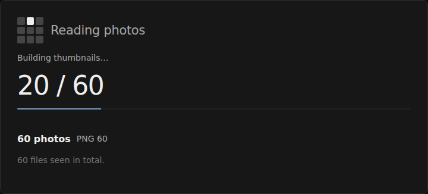
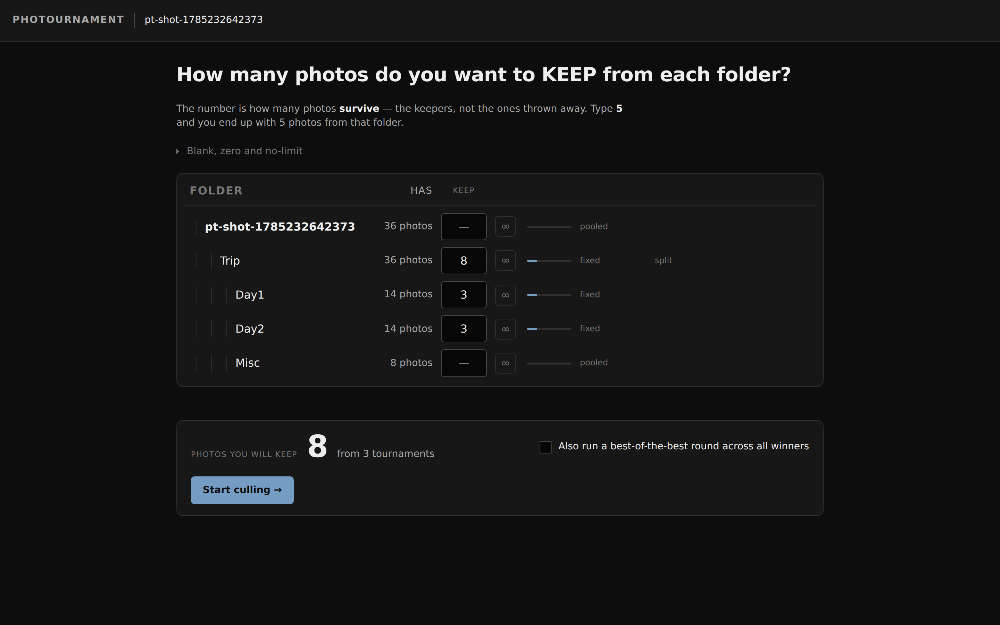
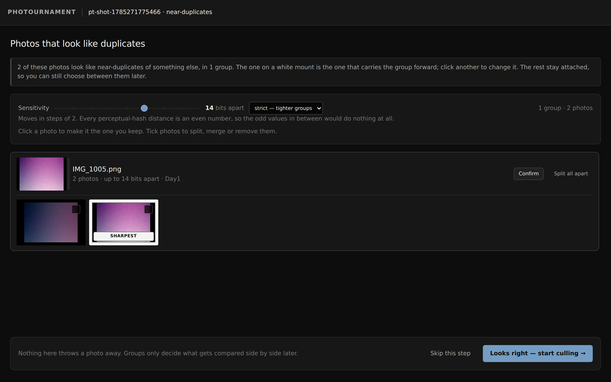
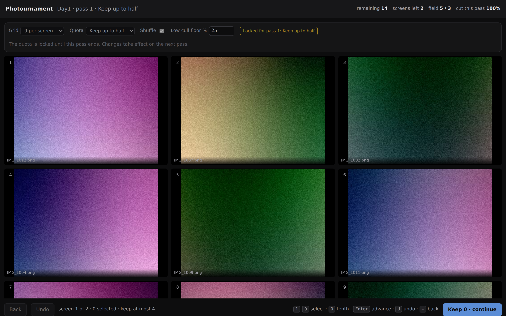
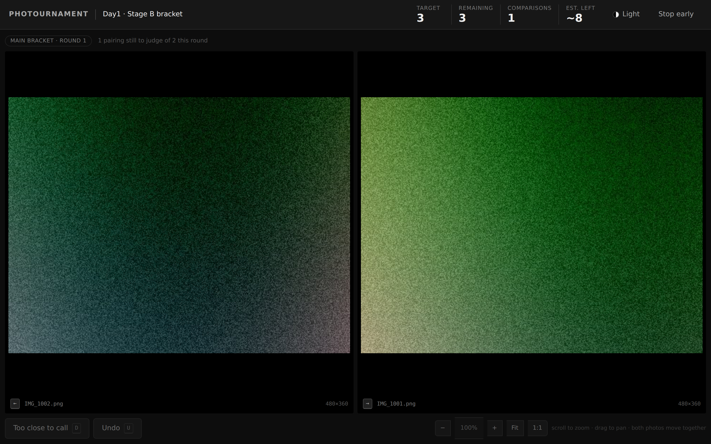
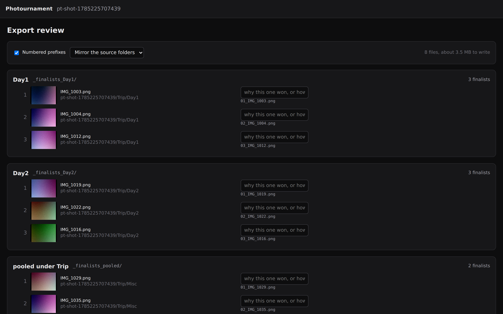

# Photournament

Narrows a folder of photos down to a small set of keepers: quota-enforced grid
passes to cut the field, then head-to-head comparison to rank what survives.
Or, as its second job, sorts and tags a whole shoot by when, where and what it
was shot with, cutting nothing.

Spec: [`photournament_prd_v1.11.md`](photournament_prd_v1.11.md).

| 1 — Ingest | 2 — Allocation | 3 — Duplicates |
| --- | --- | --- |
|  |  |  |
| **4 — Grid passes** | **5 — Bracket** | **6 — Export** |
|  |  |  |

## Running it

Two ways, and they behave identically apart from one thing.

**Download the file.** Grab `dist/photournament_v1.0.html`, save it anywhere and
double-click. Chrome, Edge, Brave or Opera — resume and writing results back to
disk need the File System Access API, which Chromium alone implements.

**Or open the hosted page**, if GitHub Pages is enabled for this repository
(Settings → Pages → Source: GitHub Actions). The workflow in
`.github/workflows/pages.yml` builds from source on every push, so the site can
never be a rebuild behind.

### Your photos never leave your machine

This holds either way. There is no server, no upload and no account. The page
reads the folder you point it at, decodes the photos in your browser, and
caches thumbnails in that browser's own storage. Nothing is transmitted
anywhere — served or not, the app makes exactly one network request: the page
itself.

Serving it over https is in fact slightly *better* than opening the file
directly, because a real origin gets its own storage bucket. Every page opened
from `file://` shares one bucket with every other local HTML page in that
browser profile.

## Building

```
npm install
npm run build     # -> dist/photournament_v1.0.html  (and a slim, no-HEIC build)
npm test          # unit tests, artifact smoke, and seventeen end-to-end runs
```

The build concatenates `src/` into one self-contained HTML file. That is not a
stylistic choice: from a `file://` origin Chromium blocks `fetch`, `XHR`, module
scripts with `src`, and relative-URL Workers, so a multi-file app cannot run
from a double-clicked file. See
[`tools/probes/01_capability_matrix/FINDINGS.md`](tools/probes/01_capability_matrix/FINDINGS.md)
for the measured constraint table.

## What it does

1. **Ingest** — point it at a folder, or hand-pick individual photos; both can
   also just be dropped on the page. Decodes JPEG, HEIC, PNG, WebP and GIF and
   builds thumbnails off the main thread, honouring the EXIF orientation tag so
   portrait shots arrive upright. Video and RAW are counted and skipped, never
   treated as errors. For a photo whose tag is wrong or missing — or a mirrored
   scan — every grid cell and bracket pane carries rotate and flip controls;
   the correction redraws the cached pixels, so it follows the photo through
   the whole tournament.
2. **Allocation** — say how many photos you want to keep from each folder. Fixed
   counts, a share of the folder (`5%`), `0` to skip, `*` for no limit, or blank
   to compete with sibling folders for whatever the parent has left over. The
   broadcast row applies one value to every folder at once — the same count
   from each, or the same share of each.
3. **Duplicates** — near-identical shots are grouped so a burst costs one
   decision rather than several: the grid deals one cell per group and the
   bracket seats one competitor per group, each wearing a badge with the member
   count. Open the badge anywhere to switch which frame stands for the group,
   expand any frame to judge it at preview size, and split, merge or remove by
   hand when the grouping itself is wrong — tick photos one by one, or drag a
   box across the review to sweep many into one action.
4. **Grid passes** — a screen of photos at a time, keeping at most the quota you
   committed to before the pass started. The cap does not move mid-pass; that is
   the entire point. **Stop early** in the top bar ends the folder whenever you
   are already happy: everything still standing — kept or simply not yet shown —
   becomes a finalist, and only the photos you actively passed over stay cut.
5. **Bracket** — survivors go head to head, with a second-chance round so a
   strong photo is not lost to an unlucky early draw.
6. **Export** — review every finalist, label it in its own words, and write the
   results to a folder, download them as one zip, or take a contact sheet.

### Sort and tag (the other job)

Pick **Sort and tag** on the entry screen instead of culling. Every photo is
kept; the screen shows the whole shoot grouped however you choose, and the
export writes an organized copy (or just the list).

- **Organize by** any of: folders, year, month, day, event (a new one after a
  gap in shooting you set), location, camera, lens, focal length, orientation,
  format, in any nesting order. "Day › Camera" is a folder per day with a
  camera folder inside each. Each choice shows how many groups it would make
  before you pick it.
- **It reads what the camera recorded**: capture time, camera, lens, focal
  length, aperture, shutter, ISO, GPS, and a written place name when the file
  has one (Lightroom and similar tools write them; phones store only
  coordinates). Photos missing something land in a named group like "No date",
  never nowhere.
- **Location stays on your machine.** GPS is read from the file; nearby
  coordinates are grouped into places you can name once ("Gion"). Nothing is
  looked up online.
- **Tags**: make up to nine (portfolio, print, client…) and apply them to a
  selection, from the large view (<kbd>Shift</kbd>+<kbd>1</kbd>…<kbd>9</kbd>),
  under each bracket photo, or on the export review. Tags never keep or cut
  anything; they ride along to the export.
- **Export**, priced before you choose: copy the shoot into a folder you pick,
  in the groups you see, with an optional folder per tag and a CSV/JSON
  manifest beside it, never overwriting anything; or download only the
  manifest.

The same **Organize by** control sits on the culling allocation screen, so a
flat camera roll can get a quota per day, per camera or per place instead of
one quota for everything. Finalists then export into folders named for their
group, and tags can become their own result sets.

Press <kbd>T</kbd> anywhere to switch between the dark and light surround. The
light theme is a mid-grey, not white, deliberately: a white surround makes a
photograph read darker and flatter than the same photograph against mid-grey,
which is the interference the whole tool exists to avoid.

## Known limits

- **Chromium only.** Other browsers can still cull, but cannot resume a session
  or write results back to disk; the app says so plainly when it detects that.
- **The folder-picker to disk-write path is untested in CI.** A native folder
  dialog cannot be driven headlessly, so the automated tests use the
  `webkitdirectory` input instead. The zip download is fully covered, down to
  parsing the archive it produces.
- **A reloaded session must reconnect its folder before exporting originals.**
  The browser hands files to a page, and they die with it. The export review
  says so and re-attaches everything in one pick; renaming, labels and the
  contact sheet never needed the originals in the first place.
- **Perceptual-hash thresholds were tuned on procedurally generated images**, not
  photographs. The defaults measure well, but real bursts are the real test.
- **Metadata is read, never written.** Tags live in the session and in the
  exported manifests and per-tag folders; originals are copied byte for byte.
  Sessions from before metadata support read as "No date" until the folder is
  added again.
- **The Sort copy path is covered in CI through the browser's private file
  system**, which speaks the same directory-handle API as the native picker;
  the picker dialog itself still cannot be driven headlessly.
- **Manual rotations and flips are visual.** They correct what you judge and the
  contact sheet, and they persist with the session — but exported files are
  written exactly as shot, byte for byte. Fix the tag in your photo app after
  export; re-encoding originals just to turn them is not worth the quality loss.
